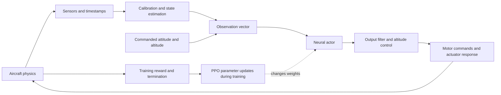

**This is a study and testing guide for your specific flight-controller project.** Work through it in order. The objective is to understand what every subsystem promises, prove those promises independently, and then establish that the complete controller works on an aircraft model supported by measurements.

The guide describes the working tree reviewed on September 12, 2026. It proposes changes; it does not claim those changes have been implemented. Existing measurements and completed checks are documented in the [dated review](../reviews/2026-09-12/review.md). Proposed numerical targets below are initial engineering targets, not aircraft safety certification or sensor specifications.

**Implementation update:** the subsequently authorized fixes 1–6 and two training experiments are now complete. Read the [changes and measured results](../../experiments/2026-09-12-fixes-1-6/REPORT.md) for current status; descriptions below of those six defects refer to the original reviewed state.

**Returning to the physical drone:** start with the [current hardware, deployment and monitoring guide](08-return-to-hardware.md). It records the remaining simulation/firmware differences, automatic motor startup, existing UART wiring/logging commands, and the staged work required before powered controller tests.

Use two passes through the guide. First, study the code and establish a consistent software baseline using explicitly labeled nominal assumptions. Correct the known physics and controller/test discrepancies and run the computer-only experiments. Then collect physical measurements to replace assumptions, validate the sensor/actuator models, and repeat the same benchmarks. You can make substantial simulation progress before every hardware parameter is measured.

| Read in order | What you will learn and produce |
| --- | --- |
| [01 — Understand every source file](01-code-walkthrough.md) | Read the code in dependency order; trace one control tick and one training episode; understand firmware startup, drivers, tests and artifacts. |
| [02 — Measure the aircraft and prove its physics](02-aircraft-and-physics.md) | Measure mass, geometry, CoG, inertia, thrust, torque and motor dynamics; build isolated physics tests and a calibrated actuator model. |
| [03 — Measure sensors and validate estimation](03-sensors-estimation-and-timing.md) | Establish frames, calibration, timing, noise, sensor lag, barometer behavior and AHRS correctness against independent references. |
| [04 — Understand and test the complete controller](04-controller-and-neural-network.md) | Trace the 12 observations, neural inference, filters, altitude control, motor mapping, numerical failures and shared C execution in simulation. |
| [05 — Validate simulation and train deliberately](05-simulation-validation-and-training.md) | Repair the environment/test contract, define scenarios and metrics, understand PPO/rewards/curriculum, and compare models fairly. |
| [06 — Run reproducible real-versus-sim experiments](06-experiment-playbook.md) | Use repeatable protocols, logging schemas, measurement ledgers, uncertainty, replay, acceptance gates and the existing hardware tests. |
| [07 — Make adjustments in a controlled sequence](07-adjustments-and-work-plan.md) | Follow a dependency-ordered implementation plan, use existing commands correctly, and diagnose failures without changing several causes at once. |
| [08 — Return to hardware and monitor results](08-return-to-hardware.md) | Refresh the current startup and deployment paths, identify real-world failure modes, reconnect telemetry, and progress through measured hardware tests. |

Your system has three feedback paths to understand:



Training changes the actor's weights between collected rollouts. In deployed firmware those weights are fixed. The feedback loop still depends on sensors, estimators, filters, actuator response and time; exporting the correct neural weights alone does not make the complete loop equivalent.

For every subsystem, answer the same six questions in a notebook: what goes in, what comes out, what units/frame/timestamp those values have, what state persists, how failure is detected, and what experiment independently demonstrates correctness. If you cannot write those answers for a function, study and test that function before tuning its parameters.

Use three labels in your notes. **Observed** means measured in this repository or on a documented physical setup. **Assumed** means a placeholder awaiting measurement. **Proposed** means a design or test you intend to implement. For example, 1.338 kg is the observed current simulated aircraft mass; 8.5 N per motor is currently an assumed actuator capability; replacing the present thrust map with calibrated curves is proposed. Never silently promote an assumption into a measured specification.

The present baseline is useful: the current best model showed roughly 2.36 cm altitude RMSE across five 30-second nominal hover runs, while the latest final model showed roughly 65.2 cm. However, the best model also moved horizontally by up to 4.1 m. Physics currently includes an extra 0.220 kg of motor mass, and the firmware uses a different filtering/observation/altitude path. Preserve the best model and use these results to measure the effect of subsequent changes.

Your first target should be a specified **attitude and altitude stabilization task**. Add takeoff, landing, position hold and wider command tracking as explicit later tasks. An aircraft cannot remain horizontally stationary against a lateral force while also maintaining exactly level attitude unless it has some other means of producing lateral force. This matters when writing wind-test requirements and rewards.

Some existing firmware is inappropriate for passive measurements: normal startup commands motors automatically, the tilt cutoff is ineffective, and the test harness automatically reaches motor tests. Begin on the computer and with unpowered mechanical measurements. Before any electronics-on or powered-actuator protocol, create an explicitly selected bench mode with no automatic arming/motor activity, verify stop behavior, and use an independent power disconnect. Thrust measurements require an appropriate guarded, rated measurement fixture; the current test-14 kitchen-scale/tape instructions are not a validated fixture design.

You can repeat the historical software baseline from the repository root:

```bash
fc-nn/.venv/bin/python docs/reviews/2026-09-12/run_baseline.py
fc-nn/.venv/bin/python fc-nn/test_env_physics.py
make host-test
fc-nn/.venv/bin/python fc-nn/test_firmware_sim.py --runs 5 --duration 30
```

The physics and host-filter checks currently fail; that is useful evidence, not a reason to loosen their assertions until everything is green. The firmware-style simulator currently exits successfully even when its performance is poor. Its printed diagnosis is not an automated acceptance gate.

Keep a small set of working documents as you proceed: an annotated source map, a units/frame contract, an aircraft parameter ledger, an experiment log, a benchmark result table, and an issue list that names the next discriminating test for each uncertainty. Templates and detailed protocols appear in the linked chapters. You should finish each work session with an explanation and a recorded result, rather than only a changed constant.
