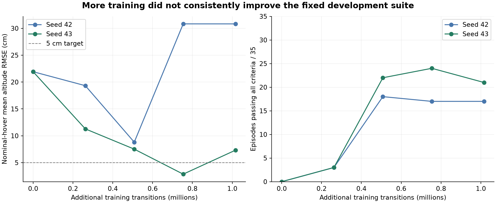
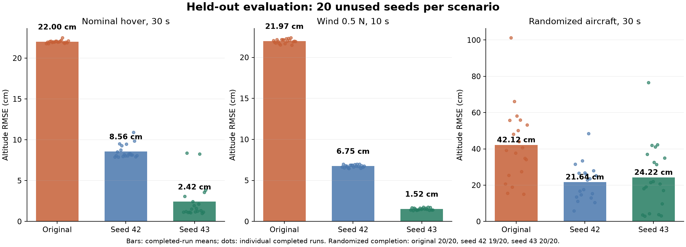

**Changes 1–6 are implemented and verified. Two new PPO warm-start experiments improved performance on the corrected plant, but the complete simulation acceptance suite still fails.** The strongest selected candidate is [seed 43's best checkpoint](training_seed43/best_model.zip), saved after 753,664 additional transitions. It is a simulation candidate; the root firmware weights were preserved.

Across 20 unused seeds per scenario, this candidate achieved mean altitude RMSE of **2.42 cm in nominal hover** and **1.52 cm with 0.5 N wind**. Randomized hover remained inconsistent at **24.22 cm mean RMSE**, and horizontal drift exceeded the declared 2 m test-area envelope. It completed all 140 held-out episodes and passed all criteria in 94 of them.

**What changed and how it was checked.**

| Requested fix | Implementation | Verification/result |
| --- | --- | --- |
| 1. Tilt cutoff overwritten later in the loop | [main.c](../../main.c) now bypasses the rest of the tick after a stop. [flight_safety.c](../../flight_safety.c) also gates the final motor writes and latches faults until MCU reset. All four commands are checked before any is applied. | Actual C host test verifies normal motor mapping, excessive tilt, attempted late writes, continued stop after returning level, and invalid inputs. Pass. |
| 2. AHRS zero-gradient division | [ahrs.c](../../ahrs.c) skips correction when the gradient is effectively zero, validates inputs/norms, and retains the last valid orientation on rejected updates. Status is available through `ahrs_is_valid()`. Native builds substitute the platform square root while retaining estimator arithmetic. | Actual C passes 10,000 exact-rest updates, gyro-only rotation, a known supported tilt, quaternion norm checks, and invalid/very small inputs. ARM link passes. |
| 3. Stale builds/weights | [Makefile](../../Makefile) tracks headers, linker script and effective compile command. Content signatures handle same-second edits as well as flag changes. Golden vectors regenerate from the actual header without requiring Torch. Separate target paths preserve existing binaries during review builds. | Seven disposable-copy rebuild/skip checks pass: unchanged content skips; weights/header/linker/flags changes rebuild; unchanged flags skip; reverting flags rebuilds. |
| 4. Faulty validation | [evaluation.py](../../fc-nn/evaluation.py) supplies fixed seeded scenarios, full-duration checks, sustained recovery, drift bounds, physical-time metrics, failure reasons and JSON/trajectory output. [validate.py](../../fc-nn/validate.py) uses it, fixes residual-to-PWM display, and fails its exit status on parity/acceptance failure. Environment reset options initialize the test state through the normal reset path. | Thirteen simulation/metric regressions pass, including complete repeated reset, no surprise setpoint changes, free fall/hover, compounded initial angles, invalid actions, incomplete episodes, crash handling and one-sample recovery rejection. SB3 environment checker passes. |
| 5. Double-counted aircraft mass | [quadrotor.xml](../../fc-nn/quadrotor.xml) now represents nominal whole-aircraft mass/inertia in the root inertial body. Fixed motor/prop geometry adds no further mass. Density randomization scales mass and inertia together from their nominal values. | Flying mass is 1.118 kg; the calculated 0.322576 hover command maintains equilibrium. The old model's flying mass was 1.338 kg. |
| 6. Ineffective CoG variation | [drone_env.py](../../fc-nn/drone_env.py) disables the compiled same-frame optimization for the changing inertial frame and updates derived constants with `mj_setConst`. | Effective inertial displacement and angular acceleration match analytical predictions for both signs of an offset, including a rotated aircraft. Returning to zero CoG restores the nominal state. |

The 1.118 kg value is the repository's intended nominal total, not a new physical weighing. The diagonal inertia `(0.018, 0.018, 0.035) kg m²` is now explicitly treated as a whole-aircraft estimate. Removing the extra component inertias is part of fixing that accounting convention; the flight-behavior comparison therefore measures a **mass/inertia model correction**, not an isolated mass-only physical intervention. These values still need measurement validation.

The filename `baseline_mass_only.json` means “fix 5 with CoG held at zero,” and includes that inertia-accounting correction. `baseline_corrected.json` additionally enables effective CoG randomization.

**Experiment design.** The starting source and dirty patch were preserved in `before/`, [before.patch](before.patch) and [manifest-before.json](manifest-before.json). Existing `test_harness.c` edits and both root weight headers were verified unchanged by this task. New binaries were built under `/tmp/fc-fixes-build`; no device was flashed.

First, the same original best policy was evaluated on three plants: the original dynamics, corrected whole-aircraft mass/inertia with zero CoG variation, and the corrected model with effective CoG variation. Each used the same new evaluator, seven scenarios, and seeds 100–104. The legacy adapter deliberately retains the original physics/derived-state behavior while providing the fixed test contract. These are fresh comparable measurements; the older review's numbers used its own historical diagnostic procedure.

Then two separate warm starts used training seeds 42 and 43. Each started from `fc-nn/runs/quad_hover/best_model.zip` and requested 1,000,000 additional transitions. PPO's full rollouts produced **1,015,808 actual additional transitions per run**, or **2,031,616 combined**. Four environment workers were used; training runs were sequential. Some held-out evaluation ran alongside the second training run. Runtime, including periodic development evaluation, was about **299 seconds for seed 42** and **319 seconds for seed 43**.

The actor architecture stayed **12 → 32 ReLU → 32 ReLU → 4**. Reward coefficients, action mapping, software EMA and PPO learning hyperparameters were preserved. Each controlled experiment used the original training task at **fixed curriculum zero**, with its normal command and domain randomization. This isolates a warm start under corrected physics; it does not resume the historical curriculum or repair the production `train.py` bookkeeping issue from item 8.

Checkpoints were evaluated periodically on the fixed development seeds. Selection prioritized the number of episodes passing all criteria, then completion count, then a documented error-based tiebreaker. Selection used development results, not the held-out set. Final checks used seeds **1000–1019**, giving **140 held-out episodes per policy**. With plant ablations and periodic training evaluations included, **945 benchmark episodes ran; 943 completed their full duration**. The two terminated episodes remain in the saved results.

**The physical fixes exposed compensation learned on the old aircraft model.** These are development-seed results with the original policy held constant:

| Plant | Nominal hover altitude RMSE | Wind altitude RMSE | Randomized hover altitude RMSE | Full-suite passes |
| --- | ---: | ---: | ---: | ---: |
| Original plant | 2.36 cm | 3.82 cm | 11.40 cm | 18/35 |
| Corrected mass/inertia, CoG held at zero | 21.93 cm | 21.84 cm | 25.40 cm | 0/35 |
| Corrected mass/inertia and effective CoG | 21.93 cm | 21.84 cm | 25.34 cm | 0/35 |

All 105 episodes in this ablation completed. The old policy's strong altitude result on the original model was compatible with incorrect physical accounting. Correcting the model degraded that old policy's equilibrium, so retraining was warranted. Effective ±2 mm CoG variation had a small mean effect in these five randomized cases; the analytical test establishes that the offsets now work, while this small sample does not establish broad CoG robustness.

**Retraining helped, and later checkpoints were not consistently better.**

| Training seed | Selected checkpoint: additional transitions | Selected development passes | Final development passes | Selected nominal-hover RMSE | Final nominal-hover RMSE |
| --- | ---: | ---: | ---: | ---: | ---: |
| 42 | 507,904 | 18/35 | 17/35 | 8.81 cm | 30.83 cm |
| 43 | 753,664 | 24/35 | 21/35 | 2.86 cm | 7.32 cm |

The same architecture recovered much of the lost nominal performance, so these results provide no reason to increase network size as the first next step. Learning and checkpoint selection remain variable across both time and training seed. The best checkpoint is preferable to blindly exporting `final_model.zip`.



**Held-out results on the corrected plant.** RMSE values below are means across completed episodes; completion counts are shown so a crash cannot disappear inside an average. The original policy and seed 43 completed all their episodes. Seed 42 terminated once during randomized hover; its randomized RMSE is conditional on the 19 completed cases.

| Metric | Original policy | Seed 42 selected | Seed 43 selected |
| --- | ---: | ---: | ---: |
| Nominal hover altitude RMSE, 30 s | 22.00 cm | 8.56 cm | **2.42 cm** |
| Wind altitude RMSE, 10 s | 21.97 cm | 6.75 cm | **1.52 cm** |
| Randomized hover altitude RMSE, 30 s | 42.12 cm | 21.64 cm, 19 completions | **24.22 cm**, 20 completions |
| Nominal combined roll/pitch RMS | 0.76° | 1.31° | 1.31° |
| Mean maximum nominal horizontal displacement | 4.27 m | 4.41 m | 3.74 m |
| Completed duration | 140/140 | 139/140 | **140/140** |
| Passed every criterion for the episode | 0/140 | 74/140 | **94/140** |



Seed 43 reduced mean nominal altitude error by approximately **89%** and wind altitude error by approximately **93%** relative to the original policy on the corrected plant. Its randomized mean error improved relative to the original, but seed 42 had a smaller completed-run randomized mean with one termination. No candidate dominates every metric.

For seed 43, per-scenario acceptance was:

| Scenario | Passed / 20 | Main outstanding failure |
| --- | ---: | --- |
| Nominal hover | 0 | Every episode exceeded the 2 m horizontal envelope; four also failed at least one non-drift criterion. |
| +30° roll recovery | 18 | Sustained recovery not achieved within the specified deadline in two cases. |
| −30° roll recovery | 19 | Sustained recovery failure in one case. |
| +30° pitch recovery | 17 | Sustained recovery failure in three cases. |
| −30° pitch recovery | 20 | All specified criteria passed. |
| 0.5 N wind | 20 | All specified criteria passed over the 10-second case. |
| Randomized hover | 0 | Drift in every case and frequent altitude/attitude errors. |

The nominal 2.42 cm average is not a guarantee that each run meets 5 cm: two nominal runs exceeded that RMSE threshold, and the worst was 8.37 cm. Worst observed nominal horizontal displacement was 3.86 m. In randomized hover, worst RMSE was 76.50 cm and worst horizontal displacement was 7.50 m. These tails are why the full verdict remains a failure despite improved averages.

The horizontal rule is a declared **test-area envelope**, not evidence that position feedback has been implemented. The present controller task lacks a horizontal-position target. There is useful attitude/altitude stabilization here, but it does not establish stationary position hold.

**Other checks and unresolved issues.**

- The selected seed-43 actor was exported to a temporary header and compiled with actual `nn.c`. Across **1,017 observations**, maximum absolute C-versus-NumPy error was **2.86e-6**, below the `1e-5` tolerance. See [candidate-c-parity.json](candidate-c-parity.json). Root `weights.h` was not replaced.
- Original-model NumPy/PyTorch parity passed, and original C inference still matched its golden references. `make host-test` still fails the two existing adaptive-filter behavior checks. That training/firmware filter mismatch was not among fixes 1–6 and has not been hidden by changing expectations.
- `test_env_physics.py` now passes its hover/accelerometer mechanical checks. Its two legacy “noise coverage” assertions still fail. Their input is a roughly 5 Hz flight log, whose first-difference variability does not identify a high-frequency noise model; those assertions should not be treated as calibrated physical requirements.
- Normal and harness ARM builds link successfully; existing diagnostics/initializer/RWX warnings remain. Native C checks verify logic and arithmetic, not measured target timing or hardware behavior.
- Changes 7–8 were not applied. Blocking telemetry, deployment/training observation and filter differences, automatic startup motor activity, measured actuator dynamics, and physical calibration remain unresolved. These policy experiments use the Python environment, not a complete C controller coupled to MuJoCo.
- During QA, a compound-angle reset test caught intrinsic versus extrinsic Euler ordering in the new reset interface. That was corrected and the regression now passes. All reported benchmark initial angles are zero or single-axis and are unaffected; default randomized training tilt uses the original explicit quaternion formula. Exact training source snapshots are archived separately from this later interface correction.

**What I would do next.** Preserve the seed-43 selected checkpoint as the best candidate from this experiment. First define the intended attitude/altitude versus position task and align simulation with the actual deployed observation/filter/altitude path. Then isolate the randomized-case failures by parameter family and evaluate across fixed difficulty levels. Extend training once those comparisons explain the dominant failures. A larger network or an unconditional longer run is not supported as the first remedy by these results.

**Reproduce the checks from the repository root.** The functioning environment is `/Users/sg/.cache/fc-sim-venv-20260912`; its recorded core versions match the original environment. Complete dependency lists and run manifests are saved alongside this report.

```bash
make host-regression
python3 host_test/test_build_dependencies.py
/Users/sg/.cache/fc-sim-venv-20260912/bin/python fc-nn/test_sim_regressions.py
/Users/sg/.cache/fc-sim-venv-20260912/bin/python host_test/test_candidate_parity.py \
  experiments/2026-09-12-fixes-1-6/training_seed43/best_model.zip \
  --out /tmp/fc-candidate-parity.json
```

Repeat the selected candidate's held-out evaluation using a new results filename:

```bash
OPENBLAS_NUM_THREADS=1 OMP_NUM_THREADS=1 \
/Users/sg/.cache/fc-sim-venv-20260912/bin/python fc-nn/run_experiment.py benchmark \
  --model experiments/2026-09-12-fixes-1-6/training_seed43/best_model.zip \
  --plant corrected --seed-start 1000 --runs 20 \
  --out /tmp/fc-seed43-repeat.json
```

That command is an experiment recorder and exits normally after recording unsuccessful episodes. Use `main.py validate ... --runs 20 --seed-start 1000 --out ...` for an acceptance-gate exit status. Its expected current result for this candidate is failure because the complete suite does not pass.

The main raw result files are [plant ablation](baseline_corrected.json), [original-policy holdout](holdout_original.json), [seed-42 holdout](holdout_seed42_best.json), [seed-43 holdout](holdout_seed43_best.json), and [comparison summary](comparison.json). Per-tick observations/actions/state are saved in `trajectories/`. Training ZIPs, source snapshots and large trajectories remain local and are excluded from Git by the experiment ignore rules. Smaller manifests, selection records, progress records, results and this report can be committed with the implementation.
