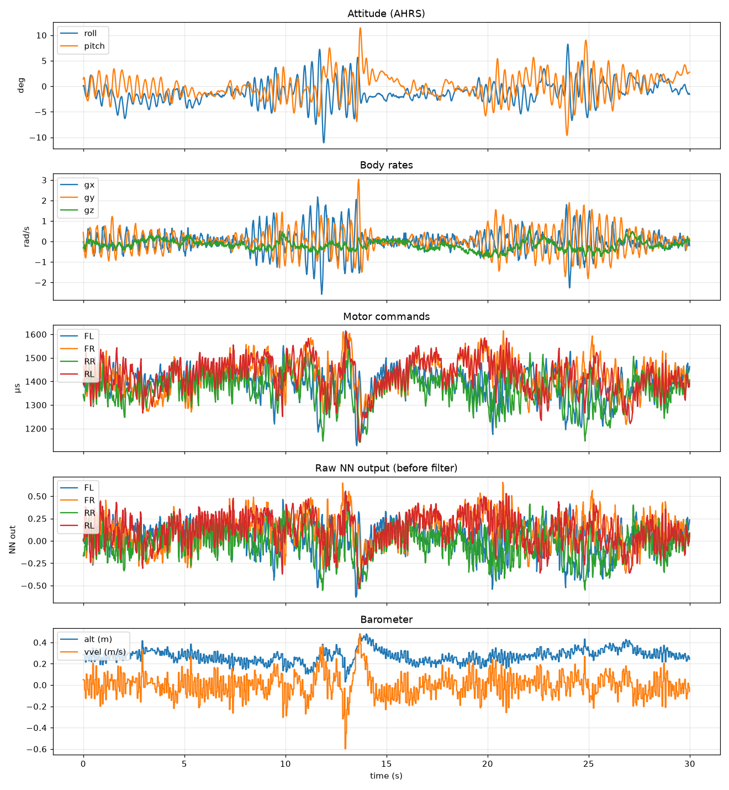

# 002 — 2.7 Hz roll/pitch oscillation in flight: ~40 ms motor delay the simulator doesn't model

**Status:** largely fixed 2026-11-22 (wobble 2.5–3× smaller in flight) · opened 2026-11-22
**Area:** training simulator (`fc-nn/drone_env.py`), firmware-in-the-loop sim (`fc-nn/test_firmware_sim.py`)
**Evidence:** `evidence/` (flight recorder pull `experiments/blackbox/2026-11-22_014814`)

## Symptom
- First flights with the thrust-curve policy (`thrustcurve_s2`, hover base 1373 µs): the drone
  "floats for a bit, then wobbles more and more violently and gets thrown off".
- The recorded flight (103 s armed, HOVER mode, mostly hand-held / hand-tethered) stayed up,
  but with **bursts of oscillation** in roll and pitch that grew and died away repeatedly.



## Evidence (`evidence/analysis.txt`, made by `evidence/analyze_oscillation.py`)

**One single peak at 2.73 Hz in both roll and pitch.** 88 % (roll rate) and 93 % (pitch rate)
of all rotation energy sits in 2–5 Hz.

```
gx    rms 0.540   2.73 Hz (1.00)
gy    rms 0.602   2.73 Hz (1.00)
roll  rms 1.978   2.73 Hz (1.00)
pitch rms 2.259   2.73 Hz (1.00)
```

**It waxes and wanes** (2-5 Hz envelope, rad/s per 2 s window). The loop is at the edge of
stability: disturbances start bursts that only slowly decay. The earlier flight that "got
thrown off" was the same oscillation going over the edge.
```
gx: 0.43 0.39 0.34 0.14 0.87 1.29 1.28 0.07 0.24 0.30 0.61 0.49 0.83 0.31 0.22
gy: 0.76 0.59 0.32 0.21 0.63 0.72 1.15 0.21 0.19 0.31 0.98 0.99 1.39 0.80 0.25
```

**The motors respond ~40 ms late.** Fitting angular acceleration against the motor command:

| model of the motors | roll R² | pitch R² |
|---|---|---|
| instant (what the simulator assumes) | 0.45 | 0.48 |
| **40 ms dead time** | **0.78** | **0.82** |
| 30 ms dead time + 10 ms lag | 0.77 | 0.81 |

The ESC signal is 400 Hz (2.5 ms), so the delay is the ESC plus the motor/prop physically
spinning up or down. At 2.7 Hz, 40 ms is ≈ 40° of extra phase lag, enough to turn the
well-damped loop the network learned in simulation into a near-sustained oscillation.

## Confirmation in simulation
The same deployed policy (`thrustcurve_s2`), run in the simulator with the measured delay
added (`drone_env.ActuatorModel`, level start at 0.3 m, nominal drone, no sensor noise
changes):

| actuator delay | roll-rate rms | result |
|---|---|---|
| none (old simulator) | 0.08 rad/s | calm hover |
| 20 ms + 5 ms lag | 0.19 rad/s | mild wobble |
| **30 ms + 10 ms lag (measured)** | **0.98 rad/s** | sustained oscillation |
| 40 ms + 10 ms lag | 4.0 rad/s | crash at 9.8 s ("wobbles more and more, thrown off") |
| 50 ms + 20 ms lag | — | crash at 1.3 s |

The simulated oscillation is ~1.8–2 Hz versus 2.7 Hz on the drone. The exact frequency
depends on inertia/turning gain, which differ (see below). The behaviour (stable without
delay, oscillating and then diverging as the delay grows) matches the flights.

## What it is NOT
- **Not a mechanical resonance or vibration.** Frame and prop resonances are 50–300 Hz.
  Accelerometer spread in flight was only 0.07–0.10 g, below the 0.22 g training noise, after
  the 25 Hz accel filter (`imu.c`) and firm mounting. The 0.6 g seen earlier came from the drone
  rocking on a narrow thrust-test stand.
- **Not loop timing.** Max loop time 550 µs of 10 ms, zero missed ticks.
- **Not saturation.** The network output never reached ±1.
- **Not thrust / hover point.** Mean motor 1378 µs vs 1372 µs measured on the scale. Altitude
  held at 0.22–0.43 m around the 0.3 m target.

## Other observations from the same log
- **Yaw:** steady clockwise drift ≈ 11°/s (gz −0.19 rad/s). The CW-spinning pair (FR+RL) ran
  42 µs above the CCW pair, i.e. the network was pushing *against* the drift. A steady rate
  rather than a runaway suggests the prop spin directions match training.
- **Average roll −1.2°**, a slight left lean.
- **Turning gain:** the fit gives 0.18–0.20 rad/s² per µs of motor difference, versus
  **0.44** in the simulator (Ixx = Iyy = 0.018 kg·m², arms 0.16 m). The real drone looks
  ~2.3× less responsive. The drone was hand-held for most of the flight, which adds inertia
  and damping, so **this number is not trustworthy**. Re-measure free (bifilar pendulum, or a
  flight on loose ground tethers).

## Fix (in progress)
- Add an **actuator delay** to the training simulator (`drone_env.py`, contract mode), randomised
  per episode around the measured value (dead time 20–50 ms + motor lag 5–30 ms), so the
  policy learns to correct earlier and more gently.
- Use the same delay in the firmware-in-the-loop simulator (`test_firmware_sim.py`) so the
  acceptance gates (`eval_contract.py`) see it.
- Randomise rotational inertia more widely until it is measured.
- Retrain, re-export, bench-check (tests 6/7/8), and fly. Then pull the log and confirm the
  2.7 Hz peak is gone or strongly damped.

## How to reproduce the analysis
```
cd issues_solved/002_attitude_oscillation_2p7hz_actuator_delay/evidence
python analyze_oscillation.py
```

## Training log
- **2026-11-22 01:58, `delay_s1/s2_20261122` (full delay from step 0): stalled and stopped.**
  At 3M steps reward was ~55–73 and episodes ~100–120 ticks (crash after ~1 s). The curriculum
  never left 0, because it only advances when the crash rate is low. This is the same deadlock as
  the collapsed 2026-11-21 yaw runs.
- **Fix:** `actuator_curriculum` scales the delay and lag ranges by curriculum progress
  (0 = instant motors → 1 = full measured range). The eval env in `train.py` always uses the
  full delay, so `best_model` is chosen on realistic motors. Test:
  `test_delay_phased_in_with_curriculum`.
- **2026-11-22 02:27:**
  - `delayc_s1_scratch_20261122`: from scratch, 16M steps.
  - `delayc_s2_warm_20261122`: warm start from `thrustcurve_s2` best model, `--curriculum_start 0`,
    12M more steps. Its step counter continues from 7.4M.
- **2026-11-22, both runs finished.** All three models were run through the same gates, with the
  delay included. None passes overall; the remaining failures are mostly the tight cosmetic limits
  (mean lean > 1°, yaw drift > 5°/s, altitude RMSE > 10 cm).

  | | old `thrustcurve_s2` (flown) | scratch best | warm best |
  |---|---|---|---|
  | G2 gated episodes passed | **4/40** | **25/40** | 20/40 |
  | hover altitude RMSE (G3 B) | 0.49 m | **0.06 m** | 0.11 m |
  | 40 ms delay, roll/pitch-rate rms | 0.98 rad/s (oscillates) | 0.16 / 0.18 | 0.12 / 0.22 |
  | 60 ms delay | crash | 0.88 / 1.46 | **0.25 / 0.34** |
  | thrust −10 % (battery sag), survived | 0/4 | 4/4 | 4/4 |
  | thrust −15 % / −20 %, survived | 0/4 | 2/4 | **4/4** |

  **Picked `delayc_s2_warm_20261122/best_model`.** It is robust to more delay than measured and to
  thrust loss as the battery drains. The cost is a looser altitude hold (≈ ±10 cm).

## Result (flight 2026-11-22 09:26, `experiments/blackbox/2026-11-22_092614`, warm model)
| | before (thrustcurve_s2) | after (delayc_s2_warm) |
|---|---|---|
| roll-rate rms (gx) | 0.540 rad/s | **0.224 rad/s** |
| pitch-rate rms (gy) | 0.602 rad/s | **0.185 rad/s** |
| share of rotation energy in 2–5 Hz | 88 % / 93 % | 54 % / 47 % |
| growing bursts → thrown off | yes | no (steady to disarm) |

What's left is a small 3.3 Hz ripple. New problems seen in this flight, each a separate issue:
yaw spin ≈ −15 °/s (435° in 30 s) with the CW pair already +80–100 µs, horizontal drift (no
position or velocity sensing, mean roll −2.3°), and mean motor 1440 µs vs 1372 µs measured on the scale.
