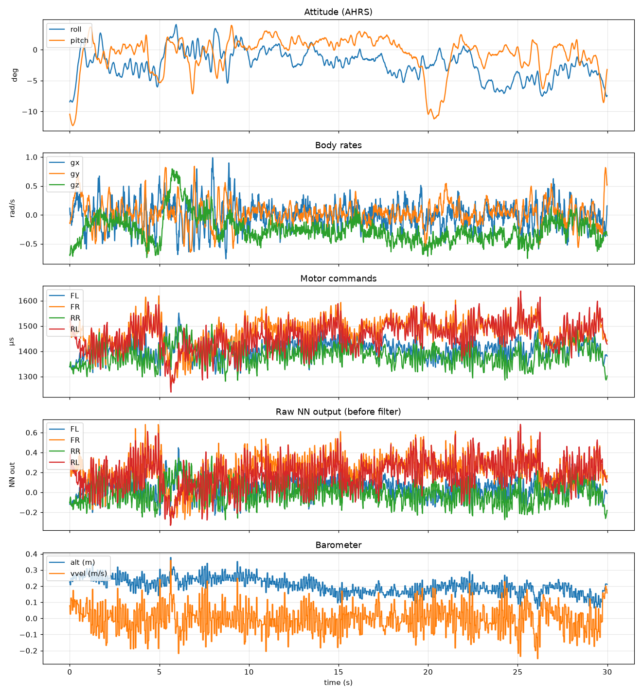

# 003 — Yaw spin, horizontal drift, and more hover thrust than the scale test predicts

**Status:** open, no confirmed solution · opened 2026-11-22
**Area:** airframe (motor/arm alignment, props), sensing (no horizontal position/velocity),
training simulator (`fc-nn/drone_env.py` randomisation), hover thrust calibration
**Evidence:** `evidence/` (flight recorder pull `experiments/blackbox/2026-11-22_092614`, warm
`delayc_s2_warm_20261122` policy, HOVER mode, 56.5 s armed, last 30 s recorded)

## Symptom
The first flight after the issue 002 fix. The wobble was much smaller, and the drone stayed up
until it was disarmed. But it **drifted a lot** sideways and slowly **turned clockwise** the
whole time.



Three separate findings came from the same log. Each one is below.

---

## A — Yaw spin: about 15°/s clockwise that the network can't stop

### Evidence (`evidence/analysis.txt`)
```
   window   roll  pitch   yaw°/s   alt m   L-R   F-R   CW-CCW   mean µs
    0- 5s   -2.8   -1.6    -15.3    0.24    +6   +15      +75      1418
    5-10s   +0.1   -0.7     +1.6    0.25    -7    +6       +2      1405
   10-15s   -1.0   +1.3    -16.5    0.21    -5   +29      +77      1439
   15-20s   -2.4   +0.4    -19.2    0.16    +4   +25      +87      1445
   20-25s   -3.4   -2.3    -22.2    0.19    +8   +18     +106      1439
   25-30s   -4.3   -1.7    -15.2    0.16   +16   +11      +83      1442
heading change over 30 s: -435° (negative = clockwise)
```
- The yaw rate holds at −15 to −22°/s, for **435° of heading change in 30 s**. In the
  simulator, the gates' yaw-spin limit is 5°/s and this policy stayed at 2.6–4.9°/s.
- The network fights it the right way. It runs the CW-spinning pair (FR+RL) **+75 to +106 µs**
  above the CCW pair, which in training means "turn counter-clockwise". It still loses, and
  the push grows over the flight.
- The 5–10 s window (push ≈ 0, yaw ≈ 0) follows a large positive yaw kick at ≈ 5 s, which
  is probably a hand touch. Don't read it as "no disturbance".
- Yaw response sign (closed-loop fit, weak, correlation ≈ 0.2): raising the CW pair produced a
  CCW turn, which **matches training**. The prop spin directions are therefore probably right,
  though this isn't proof.

### Hypotheses (not yet tested)
1. **A steady yaw torque from the airframe**, bigger than anything the simulator randomises.
   The sim only varies the per-motor torque ratio (±10 %) and thrust; it never tilts a motor.
   On an F450, a slightly twisted arm or a motor that isn't vertical is common. 1° of motor tilt
   gives ≈ T·sin(1°)·arm ≈ 2.7 N · 0.017 · 0.16 m ≈ 0.008 N·m, which is the same size as the
   whole yaw imbalance the sim trains against. Mismatched or badly seated props, or one weaker
   motor, do the same.
2. **The real yaw authority is lower than the sim's** (`KM_KF_RATIO = 0.02`; for 10" props it
   is often 0.01–0.016). The policy's yaw push would then be too weak for the real drone.
   Each motor-µs of push would turn the drone less than training expects.
3. **Prop directions reversed vs training.** Unlikely: the sign fit says no, and a reversed
   yaw loop should run away rather than hold a steady rate. Not yet confirmed on the bench.

### What to try
- `make flash-test TESTS=10` (props off): confirm each motor's spin direction matches training
  (FL/RR CCW, FR/RL CW).
- Look down each arm from the front and the side. Check that every motor axis is vertical and
  the arms aren't twisted in the clamp, and that all four props are the same model and fully seated.
- Sim side: randomise a steady yaw disturbance torque (motor tilt) and a wider `KM_KF_RATIO`
  range, so the policy learns to push harder for a steady yaw error.

---

## B — Horizontal drift: the drone has no way to sense it

### Evidence
- Mean AHRS roll **−2.3°** (left low), growing from −2.8° to −4.3° over the flight. Mean
  pitch −0.7°.
- Network inputs `obs[10–11]` (horizontal velocity) are always 0 in the firmware (`main.c`, no
  optical flow or GPS). The policy can only hold "level as the AHRS sees it". It can't
  see that it's moving.
- What a steady lean does with no position feedback:
  ```
  steady 1° lean: 0.17 m/s² → 0.8 m after 3 s,  8.6 m after 10 s
  steady 2° lean: 0.34 m/s² → 1.5 m after 3 s, 17.1 m after 10 s
  ```
- The simulator shows the same thing: the gates logged 50–100 m maximum drift over 30 s, and
  the policy has a small steady lean (G2 `steady_lean`, mean roll −1.1°).
- The yaw spin (A) rotates a fixed body-frame lean around, so the drift curves.

### Contributing causes (not yet separated)
1. **Structural:** no horizontal position or velocity sensor. The drone *will* drift without one.
2. **The policy's own lean bias** (sim: about 1°).
3. **The AHRS "level" isn't true level** (board mount angle or accel offset). Not measured.

### What to try
- Fix A first. While the drone is spinning, the drift direction can't be read.
- **Trim:** a fixed roll/pitch offset subtracted in the attitude observation. `main.c` already
  computes `obs[6–7] = attitude − setpoint`. Set it from a consistent drift direction.
- **Optical flow + rangefinder** (UART module) → `obs[10–11]`, retrained with realistic flow
  velocity noise. This is the real fix for position hold indoors, and it would also give
  better height than the barometer at 20–30 cm.
- Pilot correction: STICK mode lean setpoints (`RC_STICK_LEAN_ENABLE`), once a
  setpoint-trained policy is confirmed.

---

## C — Hover needed ≈ 28 % more thrust than the kitchen-scale test predicts

### Evidence
```
mean motor 1431 µs vs scale hover 1372 µs → +28 % thrust on the measured curve (T ∝ (u+0.015)^1.745)
mean az 0.990 g (≈1 → not climbing), altitude 0.06…0.38 m (target 0.30)
```
- The drone sat **below** the 0.3 m target (mean 0.20 m), so the altitude PD was adding
  thrust, and it still didn't climb. On the previous flight (issue 002) the mean motor was 1378 µs.
- The altitude correction is capped (base + `ALT_ADJ_MAX` ≈ 1473 µs). Much more of a
  shortfall and it can't hold height.

### Hypotheses (not yet tested)
1. **Battery state:** a partly discharged pack (voltage sag) gives less thrust per µs.
   Unknown which pack or charge level this flight used.
2. **Extra load:** a tether or hand carrying or pulling weight.
3. **Scale test vs free air:** the inverted-prop thrust test on a scale may read high
   (prop wash against the table and scale).

### What to try
- Log battery voltage in the flight recorder, if the board has a VBAT divider. This is the
  missing number.
- Note pack and charge level for each flight. Fly once on a full pack, with no hand or tether load.
- If it's confirmed, re-measure hover in free air (TEST 16 liftoff point on a full pack). Then
  update `HOVER_THROTTLE` / the thrust curve and retrain with a wider `thrust_scale_range`.

---

## How to reproduce the analysis
```
cd issues_solved/003_yaw_spin_horizontal_drift_extra_thrust/evidence
python analyze_drift.py
```

## Log
- **2026-11-22:** opened from flight `2026-11-22_092614`. No fixes tried yet.
- **2026-11-22, B fix implemented (not yet flown): stored level calibration.** The cause it targets:
  `main.c` used to zero the accelerometer at every power-up, so the slope of whatever the drone
  booted on became its "level" for that flight.
  - **Harness TEST 18** (`make flash-test TESTS=18`) measures on the same spot twice, rotated
    180°. offset = (a0 + a180)/2 cancels the surface slope, so the table doesn't need to be level.
    It saves to flash sector 10 (`level_cal.c`, magic `LVL1`, checksum, read-back verify).
  - **`main.c`** uses the stored offset from tick 0 and prints `LEVEL: stored calibration` plus
    the boot surface's tilt. The gyro is still re-zeroed at boot. Without a stored calibration
    it falls back to the old behaviour, with a warning.
  - **Supporting changes:**
    - flash primitives moved to `flash.c`, shared with `blackbox.c`;
    - `linker.ld` FLASH 896K → 768K, reserving sector 10;
    - blackbox flag bit 6 = `level_cal`, decoded by `pull_log.py` into the CSV and summary;
    - host test `host_test/test_level_cal_host.c` (in `make host-regression`).
  - **To verify:** the next log's summary should say `level reference: stored calibration`. Compare
    mean roll/pitch and the drift direction with this flight.
